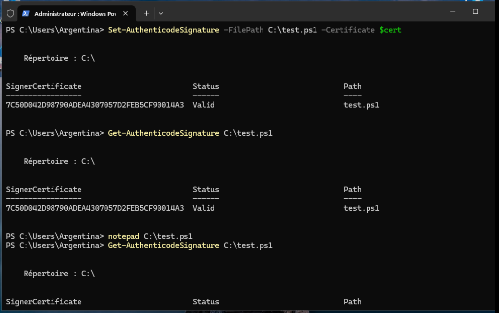
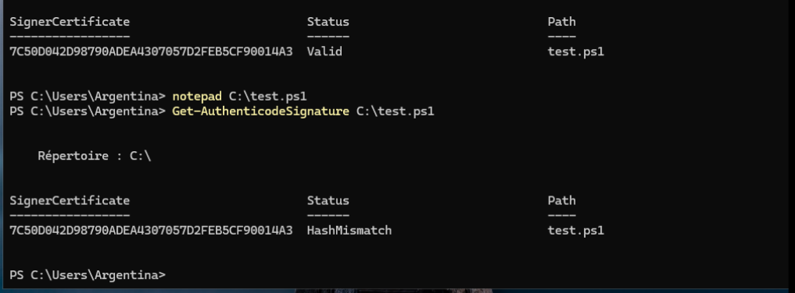
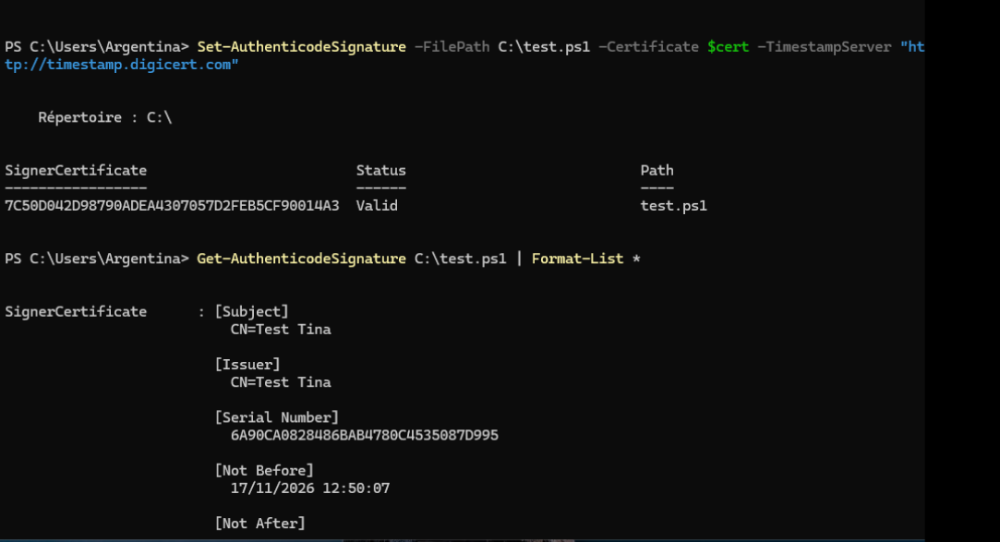
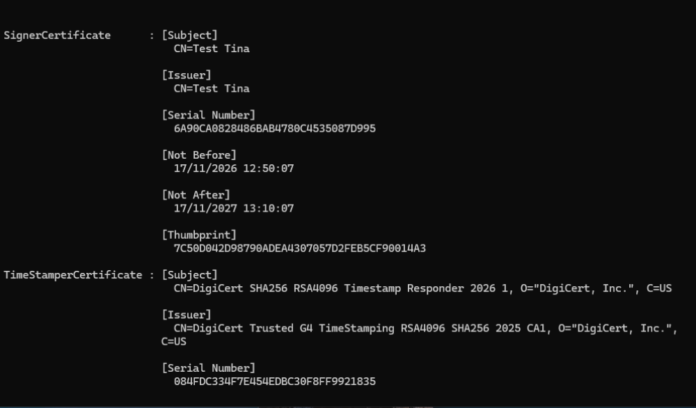
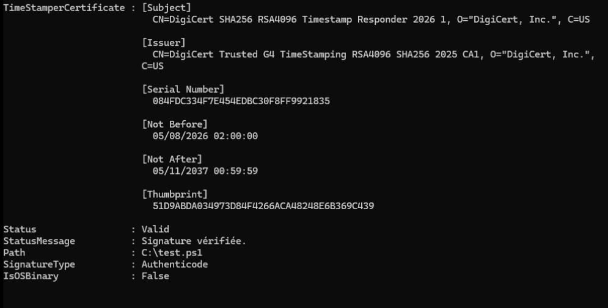

# Lab : signer un script PowerShell et voir la signature échouer

## Objectif

Comprendre concrètement la **signature de code** : prouver qu'un script n'a pas été modifié depuis qu'il a été signé.

Je voulais passer de « je connais le principe » à « je l'ai fait moi-même ». Le lab dure environ 20 minutes.

## Environnement

- PC hôte : Dell OptiPlex sous Debian 13
- Virtualisation : KVM avec virt-manager
- VM : Windows 11 26H1 (x64), UEFI avec Secure Boot et TPM 2.0 émulé
- Outil : PowerShell lancé en administrateur

## Les mots à connaître (en simple)

| Mot | Ce que c'est |
|---|---|
| **Script** | Un petit fichier texte qui contient des commandes (ici `test.ps1`). |
| **Empreinte (hash SHA-256)** | Une sorte de « photo » du fichier, sous forme d'un long code. Si on change une seule lettre, le code change complètement. |
| **Clé privée** | Mon secret. Elle sert à signer. Je ne la partage jamais. |
| **Clé publique** | La partie que tout le monde peut voir. Elle sert à vérifier la signature. |
| **Certificat** | Une carte d'identité numérique : elle contient la clé publique et dit à qui elle appartient. |
| **Signature** | L'empreinte du fichier, « tamponnée » avec ma clé privée et rangée dans le fichier. |
| **Autorité de confiance (Root)** | La liste des certificats auxquels Windows fait confiance. |

## Le principe en une phrase

Je signe le script : Windows calcule son empreinte et la verrouille avec ma clé privée. Quand je vérifie plus tard, Windows recalcule l'empreinte et la compare. Si elles sont identiques, le fichier n'a pas bougé. Sinon, il a été modifié.

## Étape par étape

### 1. Créer un certificat de test

```powershell
$cert = New-SelfSignedCertificate -Type CodeSigningCert -Subject "CN=Test Tina" -CertStoreLocation Cert:\CurrentUser\My
```

**Ce que ça fait :** je fabrique ma propre carte d'identité numérique, valable pour signer du code. « Auto-signé » veut dire que c'est moi qui me l'accorde, pas une organisation officielle.

La variable `$cert` garde ce certificat en mémoire pour la suite. Pour vérifier qu'il existe, je tape `$cert` et je vois son empreinte (Thumbprint) et son nom `CN=Test Tina`.

### 2. Dire à Windows de me faire confiance

```powershell
Export-Certificate -Cert $cert -FilePath C:\test.cer
Import-Certificate -FilePath C:\test.cer -CertStoreLocation Cert:\CurrentUser\Root
```

**Ce que ça fait :** par défaut, Windows ne connaît pas mon certificat et il ne lui fait pas confiance. Je l'exporte dans un fichier (`test.cer`), puis je l'ajoute à la liste des autorités de confiance. Sans cette étape, la vérification donnerait « UnknownError ».

> J'ai aussi essayé d'importer le certificat dans `TrustedPublisher`, mais j'ai eu une erreur « Accès refusé ». Je n'ai pas cherché à la corriger : cette étape n'est pas nécessaire pour obtenir un statut `Valid`.

### 3. Créer le script à signer

```powershell
"Write-Host 'Bonjour'" | Out-File C:\test.ps1
```

**Ce que ça fait :** je crée un tout petit script d'une seule ligne, qui affiche « Bonjour ». C'est mon cobaye.

### 4. Signer le script

```powershell
Set-AuthenticodeSignature -FilePath C:\test.ps1 -Certificate $cert
```

**Ce que ça fait :** Windows calcule l'empreinte du script, la verrouille avec ma clé privée et ajoute la signature à la fin du fichier (un bloc qui commence par `# SIG # Begin signature block`).

### 5. Vérifier la signature

```powershell
Get-AuthenticodeSignature C:\test.ps1
```

**Résultat :** le statut est **`Valid`**. Windows a recalculé l'empreinte, l'a comparée à celle de la signature, et elles sont identiques.



### 6. Modifier le script d'une seule lettre

```powershell
notepad C:\test.ps1
```

Dans la première ligne, je change une lettre (`Bonjour` en `Bonjouz`) sans toucher au bloc de signature, puis j'enregistre.

### 7. Revérifier

```powershell
Get-AuthenticodeSignature C:\test.ps1
```

**Résultat :** le statut est maintenant **`HashMismatch`**. Le contenu du fichier ne correspond plus à l'empreinte signée : Windows sait que le script a été modifié après la signature.



### 8. Ajouter un horodatage

```powershell
Set-AuthenticodeSignature -FilePath C:\test.ps1 -Certificate $cert -TimestampServer "http://timestamp.digicert.com"
Get-AuthenticodeSignature C:\test.ps1 | Format-List *
```

**Ce que ça fait :** je signe à nouveau le script (ce qui remplace l'ancienne signature) et j'ajoute un **horodatage**. Un serveur de confiance (ici DigiCert) ajoute un « tampon » qui dit : « cette signature existait bien à cette date ». C'est comme un cachet de la poste sur une lettre.

**Pourquoi c'est utile :** mon certificat de test n'est valable qu'un an (jusqu'au 17/11/2027). Sans horodatage, la signature serait invalide dès l'expiration du certificat. Avec l'horodatage, Windows sait que j'ai signé pendant que le certificat était valide.

**Résultat :** le statut est `Valid`, et la ligne `TimeStamperCertificate` est remplie avec le certificat du serveur DigiCert. Elle était vide avant.







## Ce que j'ai retenu

- Une signature ne cache pas le contenu : elle prouve seulement que le fichier **n'a pas changé**.
- Une seule lettre modifiée suffit à casser la vérification.
- Un certificat auto-signé marche pour un labo, mais Windows ne lui fait confiance que parce que je le lui ai dit. En entreprise, on utilise un certificat délivré par une autorité reconnue.

## Ce que je n'ai pas testé

- L'outil **SignTool** (SDK Windows).
- La politique d'exécution `AllSigned`, qui oblige Windows à n'exécuter que des scripts signés.

## Pour aller plus loin

Voir l'empreinte SHA-256 du fichier avant et après la modification :

```powershell
Get-FileHash C:\test.ps1 -Algorithm SHA256
```

Les deux codes seront totalement différents, même si je n'ai changé qu'une lettre.

## Captures d'écran

Les images sont dans le même dossier que ce README :

1. `01-signature-valid.png` : signature du script, statut `Valid` (étape 5).
2. `02-hashmismatch.png` : après modification d'une lettre, statut `HashMismatch` (étape 7).
3. `03-horodatage-commande.png` : signature avec `-TimestampServer` (étape 8).
4. `04-horodatage-resultat.png` : `TimeStamperCertificate` rempli par DigiCert (étape 8).
5. `05-signature-verifiee.png` : fin de la sortie, statut `Valid` et message « Signature vérifiée » (étape 8).
