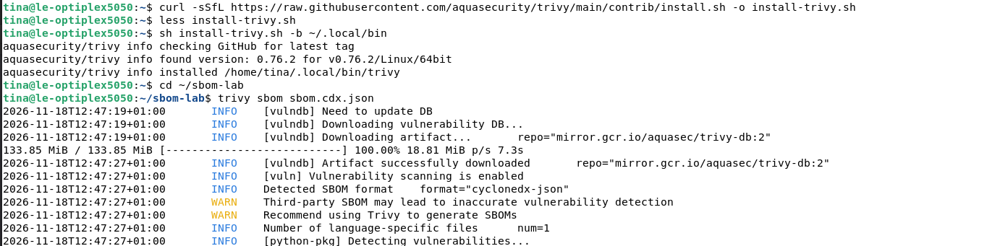
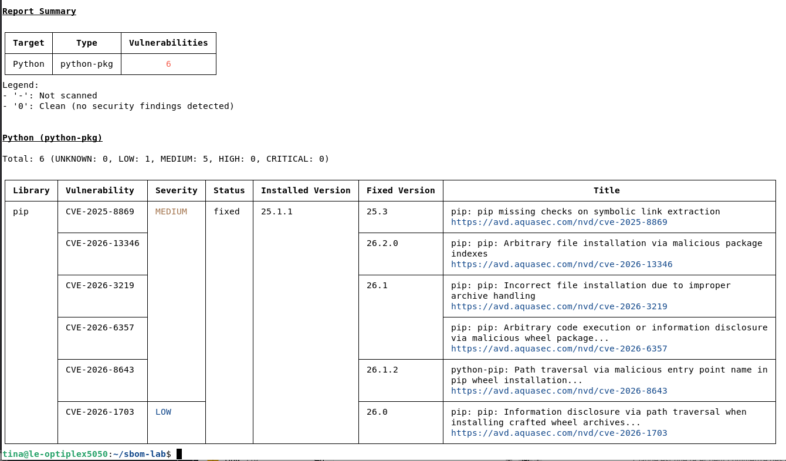

# Lab : générer une SBOM avec Syft et chercher les failles avec Trivy

## Objectif

Comprendre concrètement ce qu'est une **SBOM** (Software Bill of Materials), la liste des composants d'un logiciel avec leurs versions, puis m'en servir pour repérer les composants qui ont une faille connue.

Ce sujet est lié au **Cyber Resilience Act (CRA)** européen, qui demande aux fabricants de connaître et de documenter les composants de leurs produits.

## Environnement

- PC sous Debian 13 (système réel, pas une VM)
- Python 3.13, dans un environnement isolé (`venv`)
- Syft 1.57.2 (génère la SBOM)
- Trivy 0.76.2 (cherche les failles)

## Les mots à connaître (en simple)

| Mot | Ce que c'est |
|---|---|
| **SBOM** | La liste des « ingrédients » d'un logiciel : chaque composant, avec sa version. |
| **CycloneDX, SPDX** | Les deux formats standards pour écrire une SBOM. |
| **purl** | L'adresse unique d'un composant, par exemple `pkg:pypi/flask@3.1.3`. |
| **CPE** | Un identifiant utilisé par les bases de failles pour retrouver un produit. |
| **CVE** | Le numéro officiel d'une faille connue, par exemple `CVE-2026-13346`. |
| **Empreinte (hash, SHA-256)** | Un code de taille fixe calculé à partir d'un fichier. Il sert à vérifier qu'il n'a pas changé. |

## Étape par étape

### 1. Installer Syft

```
curl -sSfL https://raw.githubusercontent.com/anchore/syft/main/install.sh -o install-syft.sh
less install-syft.sh
sh install-syft.sh -b ~/.local/bin
syft version
```

**Ce que ça fait :** je télécharge le script d'installation dans un fichier, je le **lis avant de l'exécuter**, puis je l'installe dans `~/.local/bin`. `syft version` confirme que l'outil fonctionne (version 1.57.2).

### 2. Créer un petit projet à analyser

```
sudo apt install python3-venv
mkdir ~/sbom-lab && cd ~/sbom-lab
python3 -m venv .venv
.venv/bin/pip install flask requests
```

**Ce que ça fait :** je crée un dossier avec un environnement Python isolé, pour ne pas toucher aux paquets du système. J'y installe **Flask** et **Requests**.

Je n'ai demandé que 2 bibliothèques, mais pip en a installé **12** au total, car elles en ont besoin pour fonctionner :

```
blinker, certifi, charset-normalizer, click, flask, idna, itsdangerous,
jinja2, markupsafe, requests, urllib3, werkzeug
```

### 3. Générer la SBOM

```
syft scan dir:. --source-name sbom-lab --source-version 1.0 -o cyclonedx-json=sbom.cdx.json -o spdx-json=sbom.spdx.json
```

**Ce que ça fait :** Syft analyse le dossier et écrit la même liste dans les deux formats standards :
- `sbom.cdx.json` au format CycloneDX (36 Ko)
- `sbom.spdx.json` au format SPDX (68 Ko)

Résultat de l'analyse : **13 composants** (les 12 ci-dessus plus pip lui-même), 31 fichiers dont Syft a calculé l'empreinte, 3 exécutables repérés.

```
NAME                VERSION     TYPE
blinker             1.9.0       python
certifi             2026.10.23  python
charset-normalizer  3.5.2       python
click               8.5.1       python
flask               3.1.3       python
idna                3.20        python
itsdangerous        2.2.0       python
jinja2              3.1.6       python
markupsafe          3.0.4       python
pip                 25.1.1      python
requests            2.34.2      python
urllib3             2.8.0       python
werkzeug            3.1.9       python
```

### 4. Lire la SBOM

Le fichier CycloneDX contient quatre parties :
- **l'en-tête** : l'outil qui l'a créée (Syft), la date, et le projet décrit (`sbom-lab`, version 1.0) ;
- **les composants** : nom, version, licence, `purl`, CPE ;
- **les fichiers**, avec leurs empreintes SHA-1 et SHA-256 ;
- **les dépendances** : qui a besoin de qui. Par exemple, Flask a besoin de Jinja2, qui a besoin de MarkupSafe.

On y trouve aussi quatre licences différentes (MIT, BSD-3-Clause, Apache-2.0, MPL-2.0), utiles pour le suivi juridique.

### 5. Installer Trivy

```
curl -sSfL https://raw.githubusercontent.com/aquasecurity/trivy/main/contrib/install.sh -o install-trivy.sh
less install-trivy.sh
sh install-trivy.sh -b ~/.local/bin
```

### 6. Chercher les failles dans la SBOM

```
cd ~/sbom-lab
trivy sbom sbom.cdx.json
```

**Ce que ça fait :** Trivy télécharge sa base de vulnérabilités, reconnaît le format CycloneDX, puis compare chaque composant de la liste aux failles connues.



**Résultat : 6 vulnérabilités, toutes dans pip 25.1.1** (5 de gravité MEDIUM, 1 LOW). Aucune dans Flask, Requests ni leurs dépendances.

| CVE | Gravité | Corrigée dans |
|---|---|---|
| CVE-2025-8869 | MEDIUM | 25.3 |
| CVE-2026-13346 | MEDIUM | 26.2.0 |
| CVE-2026-3219 | MEDIUM | 26.1 |
| CVE-2026-6357 | MEDIUM | 26.1 |
| CVE-2026-8643 | MEDIUM | 26.1.2 |
| CVE-2026-1703 | LOW | 26.0 |



La version la plus récente demandée est la 26.2.0 : mettre pip à jour à cette version corrige les six.

## Ce que j'ai retenu

- Une SBOM est l'inventaire des composants d'un logiciel. Sans elle, on ne sait pas dire vite quels produits sont touchés quand une faille est publiée.
- En demandant 2 bibliothèques, j'en ai installé 12, puis 13 avec pip. Les composants hérités sont ceux qu'on oublie.
- Syft et Trivy ont deux rôles différents : l'un fabrique l'inventaire, l'autre cherche les failles dedans.
- Un hachage n'est pas du chiffrement : c'est une empreinte à sens unique, qui sert à vérifier l'intégrité.

## Limites

- Trivy a affiché un avertissement : une SBOM produite par un autre outil peut donner une détection moins précise, et il recommande de générer lui-même la SBOM.
- Les failles trouvées concernent **pip**, un outil d'installation présent dans l'environnement, pas une bibliothèque utilisée par mon application.
- Le CPE généré par Syft est une estimation (plusieurs variantes de noms) : il peut provoquer de faux positifs ou rater une faille.
- La base de vulnérabilités change tous les jours : un résultat propre aujourd'hui peut ne plus l'être demain.

## Suite prévue

1. Mettre pip à jour : `.venv/bin/pip install --upgrade pip`.
2. Régénérer la SBOM, relancer Trivy et comparer **avant / après**.
3. Essayer de faire générer la SBOM par Trivy lui-même et comparer les deux résultats.
